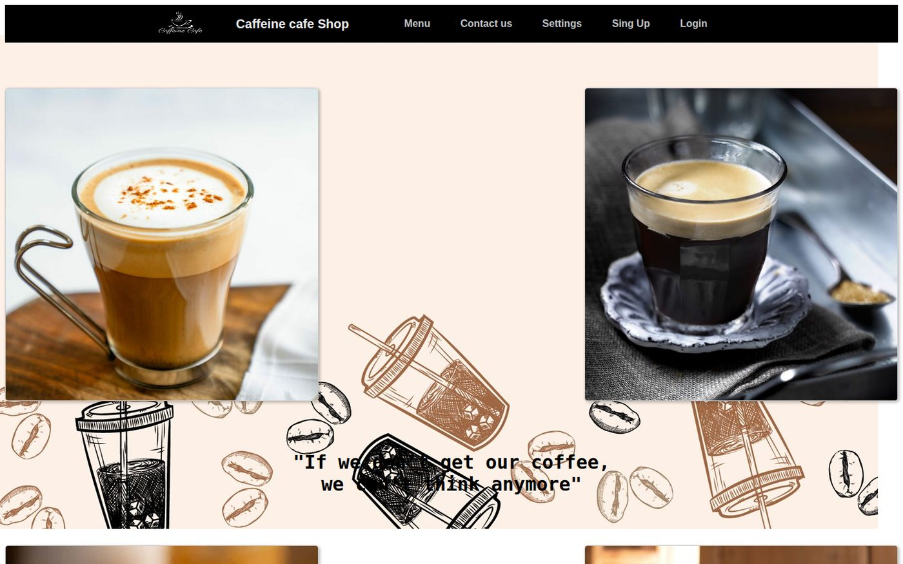
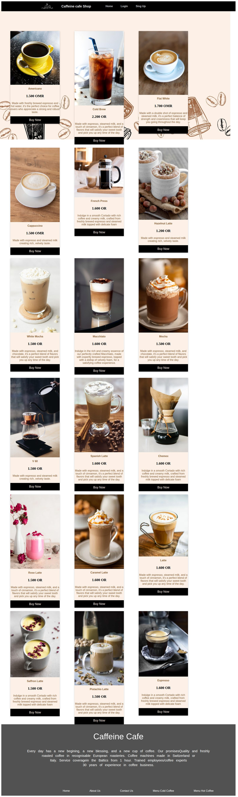
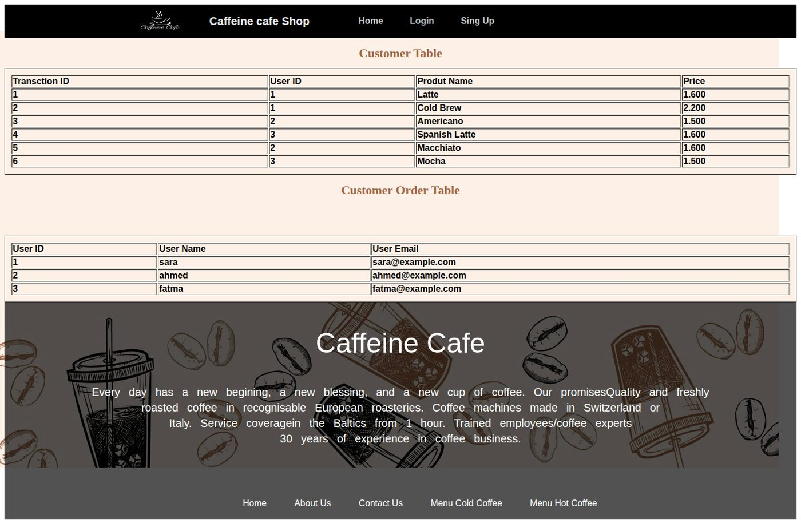

# Caffeine Cafe — Coffee Shop Ordering System

A web-based ordering system for a coffee shop, built with PHP and MySQL. Customers browse the menu, order drinks, and manage their account; administrators view registered users and all transactions from a separate admin panel.

Developed in 2023 as a university web development project.


---

## Overview

The site presents a full drink menu — 16 coffee varieties with photographs, descriptions, and prices in Omani Rial — and lets a signed-in customer add items to a cart and complete a checkout form. Behind it, a MySQL database records accounts, cart contents, and contact messages.

Everything is server-rendered PHP with shared `header.php` and `footer.php` includes, styled with a custom stylesheet and Font Awesome icons.

## Screenshots

> Add images to a `docs/` folder and link them here. The menu page is the most visual — start with that one.

| Home | Menu | Admin panel |
| --- | --- | --- |
|  |  |  |

An entity-relationship diagram is included as `erd.png` and viewable in-app at `erd.php`.

---

## Features

### Customer
- **Sign up** with username, email, password, and a security answer for account recovery
- **Login / logout** with PHP sessions; the navigation bar changes once signed in
- **Menu** of 16 drinks — Americano, Cold Brew, Flat White, Cappuccino, French Press, Hazelnut Latte, White Mocha, Macchiato, Mocha, V60, Rose Latte, Saffron Latte, Pistachio Latte, Spanish Latte, Chemex, Caramel Latte, Latte, Espresso
- **Cart** — each "Buy Now" writes the drink and price to the customer's cart
- **Checkout form** collecting billing details and payment information
- **Profile management** — update username, email, and password
- **Password reset** using the security question
- **Contact form** — customers leave a message with name, city, and comment

### Admin
- Separate admin login at `adlogin.php`
- **User Info** page listing every registered account, with delete
- **Transactions** page showing all cart records joined against customer accounts
- **ER diagram** viewer

---

## Tech stack

| Layer | Technology |
| --- | --- |
| Backend | PHP (procedural, `mysqli`) |
| Database | MySQL / MariaDB |
| Frontend | HTML5, CSS3, Bootstrap 4 (CDN) |
| Icons | Font Awesome 5 |
| Server | Apache via XAMPP |

---

## Project structure

```
caffeine-cafe/
├── index.php              # Home page
├── menu.php               # Drink menu with Buy Now buttons
├── order.php              # Adds selected drink to cart, shows checkout
├── done.php               # Order confirmation
├── cart.php               # Cart view
├── header.php             # Shared navigation bar
├── footer.php             # Shared footer
├── con.php                # Database connection (see setup)
│
├── singup.php             # Registration form
├── singupva.php           # Registration handler
├── login.php              # Login form
├── loginva.php            # Login handler
├── logoutva.php           # Session destroy
├── security.php           # Security question form
├── securityva.php         # Security question handler
├── resetva.php            # Password reset handler
│
├── profile.php            # Profile view
├── edit.php               # Edit profile form
├── editva.php             # Edit profile handler
├── Settings.php           # Account settings
├── info.php               # Account details
│
├── contact.php            # Contact form
├── contactva.php          # Contact form handler
│
├── adlogin.php            # Admin login form
├── adloginva.php          # Admin login handler
├── usersinfo.php          # Admin: list and delete users
├── transction.php         # Admin: all transactions
├── del.php                # Delete user handler
├── erd.php                # ER diagram viewer
│
├── stylee.css             # Stylesheet
└── *.jpg / *.png          # Drink photography and logos
```

---

## Setup

### Requirements
- [XAMPP](https://www.apachefriends.org/) (or any Apache + PHP + MySQL stack)

### 1. Place the files

Copy the project folder into the XAMPP web root:

- **Windows:** `C:\xampp\htdocs\caffeine-cafe`
- **macOS:** `/Applications/XAMPP/htdocs/caffeine-cafe`
- **Linux:** `/opt/lampp/htdocs/caffeine-cafe`

### 2. Start Apache and MySQL

Open the XAMPP Control Panel and start both services.

### 3. Create the database

Go to <http://localhost/phpmyadmin>, then either import `database/schema.sql` or create a database named `phplogin` and run the SQL in that file.

### 4. Configure the connection

Rename `replace it to con.php` to `con.php`, then check the credentials inside match your setup. The XAMPP defaults are:

```php
$con = mysqli_connect("localhost", "root", "", "phplogin");
```

### 5. Open the site

<http://localhost/caffeine-cafe/index.php>

### Admin login

| Username | Password |
| --- | --- |
| `admin` | `admin` |

Four admin accounts exist (`admin` through `admin4`), each with a password matching the username. These are demo credentials — see [Security](#security-notes).

---

## Database schema

Database name: `phplogin`

**`csingup`** — customer accounts

| Column | Type | Notes |
| --- | --- | --- |
| `UID` | INT | Primary key, auto-increment |
| `UName` | VARCHAR | Username |
| `password` | VARCHAR | Stored in plain text — see Security |
| `email` | VARCHAR | |
| `security` | VARCHAR | Answer to the security question |

**`cocart`** — cart items / transactions

| Column | Type | Notes |
| --- | --- | --- |
| `ID` | INT | Primary key, auto-increment |
| `Name` | VARCHAR | Drink name |
| `Price` | VARCHAR | Price in OMR |
| `UID` | INT | Customer who ordered it |

**`contact`** — messages from the contact form

| Column | Type | Notes |
| --- | --- | --- |
| `CID` | INT | Primary key, auto-increment |
| `UID` | INT | Customer who sent it |
| `FName` | VARCHAR | First name |
| `LName` | VARCHAR | Last name |
| `City` | VARCHAR | |
| `Comment` | TEXT | |

**`adminlogin`** — administrator accounts

| Column | Type | Notes |
| --- | --- | --- |
| `username` | VARCHAR | |
| `password` | VARCHAR | Plain text |

---

## Security notes

This is a coursework project from 2023 and is **not safe to deploy publicly.** Documenting the reasons is deliberate — recognising them is part of what the project demonstrates.

- **SQL injection.** Every query builds SQL by inserting `$_POST` values directly into a string. A username of `' OR '1'='1` changes the meaning of the query. The fix is prepared statements:
  ```php
  $stmt = $con->prepare("SELECT UID, UName, password FROM csingup WHERE UName = ?");
  $stmt->bind_param("s", $UName);
  $stmt->execute();
  ```
- **Passwords stored in plain text.** Anyone with database access reads every password. Use `password_hash()` on registration and `password_verify()` on login.
- **No output escaping.** User-supplied text is echoed straight into HTML, allowing cross-site scripting. Wrap output in `htmlspecialchars()`.
- **Payment fields are not processed.** The checkout form has a credit card input, but nothing stores or transmits it. Never handle real card numbers without a payment provider.
- **Admin credentials are hardcoded** in a comment inside `adloginva.php`.
- **No access control on admin pages.** `usersinfo.php` and `transction.php` can be opened directly without logging in as an admin.

## Known issues

- **Login only checks the first row** of the users table. `loginva.php` calls `mysqli_fetch_array()` once rather than filtering with a `WHERE` clause, so only the earliest-registered account can sign in. The fix is a `WHERE UName = ?` query.
- Registration reads `$row['UID']` from an unrelated `SELECT *` before the insert, so the ID shown to a new user is wrong.
- One INSERT in `order.php` (the Espresso branch) has a trailing comma and will fail.
- Some prices are labelled `OR` instead of `OMR` on the menu.
- Hazelnut Latte and Cappuccino share the button name `cp`, so they map to the same cart entry.
- Passwords are required to be exactly 8 characters, which prevents stronger passwords.
- Filenames contain typos: `singup.php` (sign up), `transction.php` (transaction), `Settings.php` inconsistently capitalised.
- The cart has no quantity field and no way to remove an item.
- Several pages link to `style.css` and `styles.css`, but the actual file is `stylee.css`.

---

## Possible improvements

- [ ] Convert all queries to prepared statements
- [ ] Hash passwords with `password_hash()`
- [ ] Add a session guard at the top of every admin page
- [ ] Move menu items out of hardcoded PHP into a `products` table
- [ ] Add quantity and remove-item support to the cart
- [ ] Replace the 16 repeated `if (isset($_POST[...]))` blocks in `order.php` with a single lookup
- [ ] Make the layout responsive for mobile

---

## License

MIT

## Author

**SoftwereEngenOMBettol** — [GitHub profile](https://github.com/SoftwereEngenOMBettol)


---

## Flutter mobile application

A separate Flutter/Dart mobile client now lives in [mobile_app/](mobile_app/). It adds a modern coffee menu, product details, search and category filters, cart quantity controls, pickup checkout, and local order tracking.

The mobile client is intentionally independent of the original PHP/MySQL website. Its menu is local and its cart/orders are in-memory demo data; it does not process payments or write to the existing database.

To set up the Flutter platform folders and run it, see [mobile_app/README.md](mobile_app/README.md).


### Restaurant backend foundation

A Supabase schema draft is available in [backend/supabase/](backend/supabase/). It defines customer/staff roles, menu items, orders, order-item snapshots, row-level security policies, and a server-side order-placement function that calculates prices. The Flutter app is not connected to Supabase yet; see the backend README for setup and the remaining integration work.
